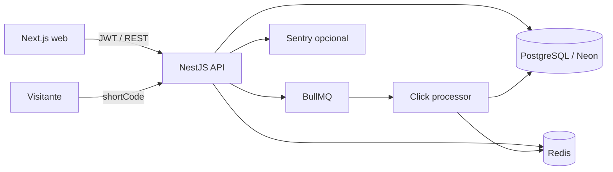

# Link Engine

Encurtador de URLs com autenticação, links expiráveis, redirecionamento público,
analytics e processamento assíncrono de cliques.

## Arquitetura



- `apps/web`: Next.js 16 e React 19.
- `apps/api`: NestJS 10, Prisma 7, BullMQ e Swagger.
- PostgreSQL/Neon: usuários, links, sessões e eventos de acesso.
- Redis: filas, rate limiting e cache de analytics.
- O worker BullMQ roda dentro da API; portanto a API deve ser publicada como
  serviço/container persistente, não como função serverless.

## Requisitos

- Node.js `>=20.19.0`.
- pnpm `9.0.0`.
- Docker, para PostgreSQL e Redis locais.

## Setup local

```powershell
pnpm install --frozen-lockfile
Copy-Item apps/api/.env.example apps/api/.env
Copy-Item apps/web/.env.example apps/web/.env
docker compose up -d
pnpm prisma:generate
pnpm --filter api exec prisma migrate dev
pnpm dev
```

Serviços locais:

| Serviço    | URL                                  |
| ---------- | ------------------------------------ |
| Frontend   | `http://localhost:3001`              |
| API        | `http://localhost:3000`              |
| Swagger    | `http://localhost:3000/swagger`      |
| Bull Board | `http://localhost:3000/admin/queues` |
| Liveness   | `http://localhost:3000/health/live`  |
| Readiness  | `http://localhost:3000/health/ready` |

A API de produção atualmente referenciada pelo frontend é
`https://link-engine-hfa1.onrender.com`. A URL pública do frontend deve ser
registrada em `NEXT_PUBLIC_APP_URL` e adicionada a `CORS_ALLOWED_ORIGINS` antes
do deploy.

## Comandos de qualidade

```powershell
pnpm prisma:generate
pnpm check-types
pnpm lint
pnpm test
pnpm build
```

`lint` apenas valida. Para aplicar correções automáticas, use `lint:fix` dentro
do app desejado.

## Variáveis de ambiente

Os arquivos de referência são:

- `apps/api/.env.example`
- `apps/web/.env.example`

Nunca versione `.env`, URLs com credenciais, tokens ou segredos. Em produção,
configure os valores no provedor e no GitHub Environment `production`.

Variáveis importantes da API:

| Variável                          | Finalidade                                                |
| --------------------------------- | --------------------------------------------------------- |
| `DATABASE_URL`                    | Conexão PostgreSQL; use a URL pooled do Neon na aplicação |
| `DATABASE_POOL_MAX`               | Máximo de conexões PostgreSQL por instância               |
| `REDIS_URL`                       | Cache, rate limiting e BullMQ                             |
| `CORS_ALLOWED_ORIGINS`            | Origens exatas, separadas por vírgula                     |
| `CORS_PREVIEW_HOST_PREFIX/SUFFIX` | Limites dos hosts de preview autorizados                  |
| `IP_HASH_SECRET`                  | Chave exclusiva usada no HMAC dos IPs                     |
| `IP_HASH_RETENTION_DAYS`          | Prazo para remover o hash; padrão 30 dias                 |
| `SENTRY_DSN`                      | Ativa o monitoramento de erros quando preenchido          |
| `SENTRY_TRACES_SAMPLE_RATE`       | Amostragem entre `0` e `1`                                |
| `APP_VERSION`                     | Commit/release incluído nos logs e no Sentry              |

## CORS e proxies

- Produção aceita somente as origens exatas em `CORS_ALLOWED_ORIGINS`.
- Previews precisam corresponder simultaneamente ao prefixo e ao sufixo
  configurados e usar HTTPS.
- `localhost:3000/3001` e `127.0.0.1:3000/3001` só são aceitos fora de produção.
- Requisições sem `Origin` são permitidas para health checks e integrações
  servidor-servidor.
- Em produção, `TRUST_PROXY_HOPS` define quantos proxies confiáveis existem
  entre o cliente e a API. O padrão é `1`.

CORS não substitui autenticação ou autorização.

## Banco, migrations e deploy

Desenvolvimento cria migrations com `prisma migrate dev`. Produção somente
aplica migrations já revisadas:

```powershell
pnpm --filter api prisma:migrate:deploy
```

O workflow `.github/workflows/quality.yml` executa `prisma generate`,
typecheck, lint, testes e build. Após um push aprovado em `main`, o job
`migrate-production` aplica migrations usando `MIGRATION_DATABASE_URL` (quando
configurado) ou o fallback `DATABASE_URL` do GitHub Environment `production`.
Prefira uma credencial exclusiva de migration, com os privilégios de DDL que a
credencial da aplicação não precisa possuir.

Para bloquear merge, execute o workflow uma vez e configure um GitHub Ruleset
para `main`, exigindo o check `quality`. Recomenda-se também exigir PR e pelo
menos uma aprovação.

### Migration de privacidade

A migration `20261022000000_pseudonymize_link_access_ip`:

1. adiciona `ipHash`;
2. apaga irreversivelmente todos os IPs brutos existentes;
3. instala um trigger que impede gravações na coluna legada durante o rollout.

A coluna `ip` foi mantida temporariamente para expand/contract. Após uma versão
estável sem instâncias antigas, ela e o trigger podem ser removidos por uma nova
migration.

## Logs, erros e health checks

A API escreve logs JSON no stdout, incluindo `requestId`, serviço, ambiente,
versão, método, rota, status e duração. O header `x-request-id` recebido é
propagado; quando ausente, a API gera um UUID.

Headers, cookies, tokens, senhas e IPs são removidos/redigidos. O provedor deve
coletar stdout e alertar, no mínimo, para:

- taxa de respostas `5xx`;
- latência p95;
- falhas finais do BullMQ;
- readiness indisponível.

Com `SENTRY_DSN`, erros HTTP inesperados e a última falha de cada job são
enviados ao Sentry sem PII padrão. Configure `APP_VERSION` com o SHA do deploy
para associar eventos a releases.

- `/health/live` verifica somente o processo.
- `/health/ready` executa checks com timeout no PostgreSQL e Redis.

O liveness não depende do banco/Redis para evitar ciclos de reinício quando um
serviço externo estiver indisponível.

## Privacidade e retenção de IP

O IP bruto não entra na fila nem no PostgreSQL. Antes de enfileirar o clique, a
API calcula `HMAC-SHA256(IP, IP_HASH_SECRET)`. Esse hash é pseudônimo, não um
dado anonimamente irreversível, e deve permanecer protegido.

País e cidade são lidos apenas dos headers do provedor (`x-vercel-ip-country`,
`x-vercel-ip-city` ou `cf-ipcountry`). A API não envia IP a serviços externos de
geolocalização.

O workflow `.github/workflows/privacy-maintenance.yml` roda diariamente e
remove `ipHash` de eventos mais antigos que `IP_HASH_RETENTION_DAYS` (30 dias
por padrão). O restante do evento permanece para métricas agregadas. Alterações
de finalidade ou prazo devem passar por revisão de privacidade/LGPD.

## Pooling e cold start do Neon

- A aplicação usa uma URL pooled do Neon e um pool padrão de 5 conexões por
  instância.
- O total potencial é `DATABASE_POOL_MAX × número máximo de instâncias`; deixe
  margem para migrations e administração.
- O timeout de conexão padrão é 5 segundos e conexões ociosas fecham em 30
  segundos.
- O Prisma conecta no startup para falhar cedo se a configuração estiver
  inválida e desconecta durante shutdown.
- Fechar conexões ociosas permite scale-to-zero, mas a primeira consulta após
  inatividade pode ter latência de cold start. Se o SLO de redirect não aceitar
  essa latência, mantenha o compute Neon ativo.

## Decisões técnicas

- BullMQ torna o redirect independente do processamento de analytics.
- Redis indisponível no rate limiting usa fallback em memória por instância.
- Migrations rodam uma única vez no pipeline, não no startup de cada réplica.
- Logs ficam no stdout; persistência e alertas pertencem à plataforma.
- Alterações destrutivas de schema devem usar expand/contract.
